# Mid-Project Komunikasi Data dan Jaringan Komputer
## Implementasi Jaringan Smart City Kota Surabaya

**Kelompok:** 7 (K = 7) · **Skema pengalamatan:** VLSM · **Base IP:** `10.56.0.0` · **Domain layanan:** `k7.smartcity.lab`

| Anggota | NRP | Peran |
|---|---|---|
| Muhammad Syadzili Abdul Muhyi | 5027251030 | Network Architect (Soal 1, 2, 3) |
| Chilmi Muhammad Ulin Nuha | 5027251003 | Core Network dan Security (Soal 5, 6, 7) |
| Arjunina Maqbulin Usman | 5027251007 | SysAdmin, Technical Writer, dan Penyusun Laporan (Soal 4 dan 8) |


## Daftar Isi

1. [Pemilihan Skema: VLSM](#1-pemilihan-skema-vlsm)
2. [Gambar Topologi](#2-gambar-topologi)
3. [Soal 1: Perancangan Topologi](#soal-1--perancangan-topologi)
4. [Soal 2: Tabel Subnetting](#soal-2--tabel-subnetting)
5. [Soal 3: Static Routing](#soal-3--static-routing)
6. [Soal 4: DHCP](#soal-4--dhcp)
7. [Soal 5: NAT](#soal-5--nat)
8. [Soal 6: Tunnel GRE (Bonus IPsec)](#soal-6--tunnel-gre-bonus-ipsec)
9. [Soal 7: Dynamic Routing OSPF](#soal-7--dynamic-routing-ospf)
10. [Soal 8: Layanan Aplikasi Smart City](#soal-8--layanan-aplikasi-smart-city)
11. [Soal 9: Demo](#soal-9--demo)
12. [Checklist Screenshot](#checklist-screenshot)

---

# 1. Pemilihan Skema: VLSM
Kelompok 7 memilih **VLSM**.

| Pertimbangan | Alasan memilih VLSM |
|---|---|
| Kebutuhan host sangat bervariasi | Ke-14 LAN membutuhkan 20 sampai 11.000 host. VLSM memberi blok sesuai kebutuhan masing-masing (prefix /18 sampai /27), sehingga tidak ada LAN kecil yang mendapat blok terlalu besar. |
| Efisiensi alamat | Total kebutuhan 42.080 host dilayani blok dengan kapasitas 61.700 host usable (pemanfaatan sekitar 68,2 persen), dan seluruhnya muat di `10.56.0.0` sampai `10.56.241.31`. |
| Link point-to-point | Tujuh link backbone memakai blok /30 yang hanya menyediakan 2 host usable, tepat untuk dua ujung router, di blok `10.56.242.0/24`. |
| Urutan alokasi jelas | Subnet dialokasikan berurutan dari kebutuhan terbesar. Gateway selalu host pertama, sehingga mudah diaudit dan dipakai untuk static route dan OSPF. |
| Topologi bintang | Setiap router cabang punya 2 LAN. Static route di R-PUSAT per subnet tetap sederhana, dan routing berbasis subnet langsung memakai blok VLSM. |

**Pembanding (CIDR):** pada CIDR, blok tiap router digabung menjadi satu supernet sehingga tabel routing lebih ringkas (route summarization). Namun pembagian blok per router cenderung kurang rapat untuk LAN-LAN yang ukurannya jauh berbeda. Karena routing di proyek ini sudah per subnet dan bisa diotomatisasi OSPF, keuntungan ringkasan rute tidak menjadi kebutuhan utama. 

---

# 2. Topologi

Topologi mengikuti Gambar 1 pada soal: R-ISP dan Server 8.8.8.8 di atas, R-PUSAT sebagai pusat bintang, lima router cabang (R-DC, R-BARAT, R-UTARA, R-TIMUR, R-SELATAN), dan R-PELABUHAN di bawah R-UTARA. Pada file OSPF ditambahkan link cadangan L7 antara R-DC dan R-UTARA.

**Screenshot: Topologi file utama K7_VLSM.pkt**                                  
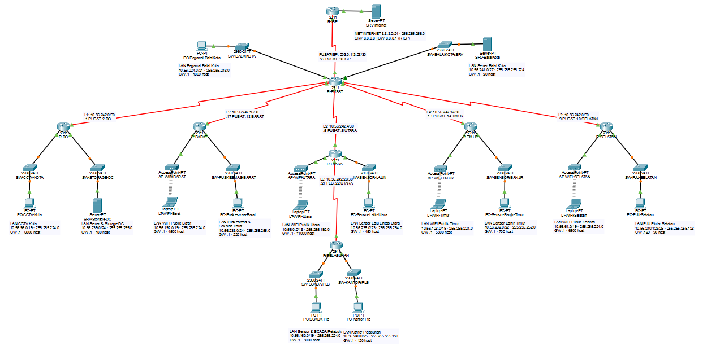

**Screenshot: Topologi file K7_VLSM_OSPF.pkt**                                      
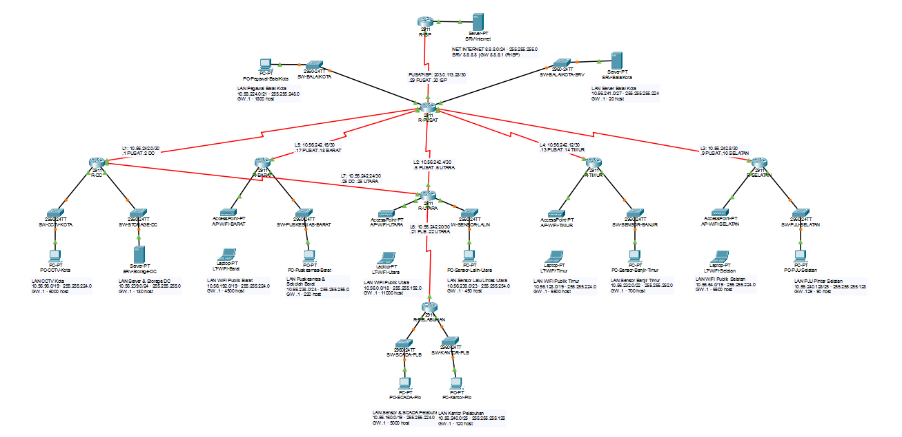

---

# Soal 1 — Perancangan Topologi

## 1.1 Perangkat

| Jenis | Model | Jumlah | Keterangan |
|---|---|:-:|---|
| Router | Cisco 2911 | 8 | R-ISP, R-PUSAT, R-DC, R-BARAT, R-UTARA, R-TIMUR, R-SELATAN, R-PELABUHAN |
| Modul serial | HWIC-2T | 11 | 2 port serial per modul. R-PUSAT 3, R-UTARA 2, router lain masing-masing 1 |
| Switch | Cisco 2960-24TT | 10 | 1 switch untuk setiap LAN kabel |
| Access Point | AccessPoint-PT | 4 | AP-WIFI-UTARA/BARAT/TIMUR/SELATAN, langsung ke `Gig0/0` router |
| End device | PC-PT, Laptop-PT, Server-PT | 15 | 1 perangkat perwakilan per LAN, ditambah Server 8.8.8.8 |
| **Total** | | **37** | 8 router, 10 switch, 4 AP, 15 end device |

Modul HWIC-2T dipasang saat router **power off**:

| Router | Modul | Port serial | Kebutuhan |
|---|:-:|---|---|
| R-PUSAT | 3 | Serial0/0/0 sampai 0/2/1 (6 port) | 1 ke R-ISP, L1 sampai L5 |
| R-UTARA | 2 | Serial0/0/0 sampai 0/1/1 (4 port) | L2, L6, cadangan L7 |
| R-DC | 1 | Serial0/0/0 sampai 0/0/1 | L1, cadangan L7 |
| R-BARAT, R-TIMUR, R-SELATAN, R-PELABUHAN, R-ISP | 1 | Serial0/0/0 sampai 0/0/1 | 1 link masing-masing |

## 1.2 Switch, AP, dan end device

| Switch | LAN yang dilayani | Router (port) |
|---|---|---|
| SW-BALAIKOTA | Pegawai Balai Kota | R-PUSAT Gig0/0 |
| SW-BALAIKOTA-SRV | Server Balai Kota | R-PUSAT Gig0/1 |
| SW-CCTV-KOTA | CCTV Kota | R-DC Gig0/0 |
| SW-STORAGE-DC | Server dan Storage DC | R-DC Gig0/1 |
| SW-SENSOR-LALIN | Sensor Lalu Lintas Utara | R-UTARA Gig0/1 |
| SW-PUSKESMAS-BARAT | Puskesmas dan Sekolah Barat | R-BARAT Gig0/1 |
| SW-SENSOR-BANJIR | Sensor Banjir Timur | R-TIMUR Gig0/1 |
| SW-PJU-SELATAN | PJU Pintar Selatan | R-SELATAN Gig0/1 |
| SW-SCADA-PLB | Sensor dan SCADA Pelabuhan | R-PELABUHAN Gig0/0 |
| SW-KANTOR-PLB | Kantor Pelabuhan | R-PELABUHAN Gig0/1 |

| Perangkat | Nama | Terhubung ke |
|---|---|---|
| PC | PC-Pegawai-BalaiKota | SW-BALAIKOTA |
| Server | SRV-BalaiKota | SW-BALAIKOTA-SRV |
| PC | PC-CCTV-Kota | SW-CCTV-KOTA |
| Server | SRV-Storage-DC | SW-STORAGE-DC |
| Laptop | LT-WiFi-Utara, LT-WiFi-Barat, LT-WiFi-Timur, LT-WiFi-Selatan | Wireless ke AP lokasinya masing-masing |
| PC | PC-Sensor-Lalin-Utara, PC-Puskesmas-Barat, PC-Sensor-Banjir-Timur, PC-PJU-Selatan, PC-SCADA-Plb, PC-Kantor-Plb | Switch LAN-nya |
| Server | SRV-Internet (8.8.8.8) | Langsung ke R-ISP Gig0/0 |

## 1.3 Kabel

| Jenis kabel | Dipakai untuk | Jumlah |
|---|---|:-:|
| Serial DCE | Backbone antar-router (termasuk R-PUSAT ke R-ISP) | 7 |
| Copper Straight-Through | Router ke switch, switch ke end device, router ke AP, R-ISP ke SRV-Internet | 25 |
| **Total** | | **32** |

| Link | Ujung A (DCE) | Ujung B (DTE) |
|---|---|---|
| PUSAT-ISP | R-PUSAT `Serial0/0/0` | R-ISP `Serial0/0/0` |
| L1 | R-PUSAT `Serial0/0/1` | R-DC `Serial0/0/0` |
| L2 | R-PUSAT `Serial0/1/0` | R-UTARA `Serial0/0/0` |
| L3 | R-PUSAT `Serial0/1/1` | R-SELATAN `Serial0/0/0` |
| L4 | R-PUSAT `Serial0/2/0` | R-TIMUR `Serial0/0/0` |
| L5 | R-PUSAT `Serial0/2/1` | R-BARAT `Serial0/0/0` |
| L6 | R-UTARA `Serial0/0/1` | R-PELABUHAN `Serial0/0/0` |

Router ke switch memakai `Gig` router ke `Fa0/1` switch, dan switch ke end device memakai `Fa0/2` ke `FastEthernet0`. Sisi DCE wajib diberi `clock rate`.

## 1.4 Pertimbangan dan alasan desain

| Keputusan | Pertimbangan |
|---|---|
| Cisco 2911 untuk semua router | 3 port Gigabit bawaan cukup untuk 2 LAN per lokasi plus 1 port cadangan |
| HWIC-2T dengan jumlah berbeda per router | Backbone memakai serial. Jumlah modul mengikuti kebutuhan port tiap router |
| Port serial disisakan di R-DC dan R-UTARA | Untuk link cadangan L7 (Soal 7) sehingga topologi tidak perlu dibongkar |
| 1 switch per LAN (2960-24TT) | Setiap LAN adalah broadcast domain sendiri dengan subnet sendiri; mudah dibaca dan dipecahkan masalahnya. 24 port jauh melebihi kebutuhan |
| Switch akses, bukan L3 | Routing sepenuhnya di router sesuai materi (static dan OSPF) |
| LAN WiFi Publik: AP langsung ke router, tanpa switch | Seluruh client wireless, sehingga tidak ada switch yang menganggur. AP bekerja sebagai bridge layer 2 |
| WiFi Publik memakai Laptop dan AP | Layanan publik yang mobilitasnya tinggi; media link wireless dipilih sesuai karakter layanan |
| Sensor, SCADA, CCTV, kantor, PJU memakai PC kabel | Perangkat tetap yang membutuhkan stabilitas |
| Server memakai Server-PT statis | Layanan DHCP, DNS, web, FTP, email membutuhkan perangkat yang selalu aktif dan ber-IP tetap |
| Backbone Serial DCE | Mencerminkan link WAN antar-lokasi dan memberi kontrol clock rate |
| Satu perangkat perwakilan per LAN | Sesuai soal; subnet tetap dihitung dari jumlah host penuh |
| Penamaan pola TIPE-LOKASI | Posisi dan fungsi perangkat langsung terbaca (R-PUSAT, SW-BALAIKOTA, PC-CCTV-Kota) |

## 1.5 Konfigurasi

### a. IP interface router

Mask /30 untuk link serial dan mask LAN sesuai Soal 2.

| Router | Port | IP | Mask | Keterangan |
|---|---|---|---|---|
| R-PUSAT | Serial0/0/0 | 203.0.113.29 | 255.255.255.252 | ke R-ISP |
| R-PUSAT | Serial0/0/1 | 10.56.242.1 | 255.255.255.252 | L1 ke R-DC |
| R-PUSAT | Serial0/1/0 | 10.56.242.5 | 255.255.255.252 | L2 ke R-UTARA |
| R-PUSAT | Serial0/1/1 | 10.56.242.9 | 255.255.255.252 | L3 ke R-SELATAN |
| R-PUSAT | Serial0/2/0 | 10.56.242.13 | 255.255.255.252 | L4 ke R-TIMUR |
| R-PUSAT | Serial0/2/1 | 10.56.242.17 | 255.255.255.252 | L5 ke R-BARAT |
| R-PUSAT | Gig0/0 | 10.56.224.1 | 255.255.248.0 | LAN Pegawai |
| R-PUSAT | Gig0/1 | 10.56.241.1 | 255.255.255.224 | LAN Server Balai Kota |
| R-ISP | Serial0/0/0 | 203.0.113.30 | 255.255.255.252 | ke R-PUSAT |
| R-ISP | Gig0/0 | 8.8.8.1 | 255.255.255.0 | NET Internet |
| R-DC | Serial0/0/0 | 10.56.242.2 | 255.255.255.252 | L1 |
| R-DC | Gig0/0 | 10.56.96.1 | 255.255.224.0 | LAN CCTV |
| R-DC | Gig0/1 | 10.56.239.1 | 255.255.255.0 | LAN Storage DC |
| R-UTARA | Serial0/0/0 | 10.56.242.6 | 255.255.255.252 | L2 |
| R-UTARA | Serial0/0/1 | 10.56.242.22 | 255.255.255.252 | L6 (DCE) |
| R-UTARA | Gig0/0 | 10.56.0.1 | 255.255.192.0 | LAN WiFi Utara |
| R-UTARA | Gig0/1 | 10.56.236.1 | 255.255.254.0 | LAN Sensor Lalu Lintas |
| R-BARAT | Serial0/0/0 | 10.56.242.18 | 255.255.255.252 | L5 |
| R-BARAT | Gig0/0 | 10.56.192.1 | 255.255.224.0 | LAN WiFi Barat |
| R-BARAT | Gig0/1 | 10.56.238.1 | 255.255.255.0 | LAN Puskesmas |
| R-TIMUR | Serial0/0/0 | 10.56.242.14 | 255.255.255.252 | L4 |
| R-TIMUR | Gig0/0 | 10.56.128.1 | 255.255.224.0 | LAN WiFi Timur |
| R-TIMUR | Gig0/1 | 10.56.232.1 | 255.255.252.0 | LAN Sensor Banjir |
| R-SELATAN | Serial0/0/0 | 10.56.242.10 | 255.255.255.252 | L3 |
| R-SELATAN | Gig0/0 | 10.56.64.1 | 255.255.224.0 | LAN WiFi Selatan |
| R-SELATAN | Gig0/1 | 10.56.240.129 | 255.255.255.128 | LAN PJU |
| R-PELABUHAN | Serial0/0/0 | 10.56.242.21 | 255.255.255.252 | L6 |
| R-PELABUHAN | Gig0/0 | 10.56.160.1 | 255.255.224.0 | LAN SCADA Pelabuhan |
| R-PELABUHAN | Gig0/1 | 10.56.240.1 | 255.255.255.128 | LAN Kantor Pelabuhan |

### b. Perintah dasar CLI

| Perintah | Artinya |
|---|---|
| `enable` | Masuk mode privileged (`Router#`) |
| `configure terminal` | Masuk mode konfigurasi |
| `hostname <nama>` | Mengganti nama router |
| `interface <port>` | Memilih interface |
| `ip address <IP> <mask>` | Memberi IP dan subnet mask |
| `clock rate 2000000` | Kecepatan clock link serial, hanya di sisi DCE |
| `no shutdown` | Menyalakan interface |
| `write memory` | Menyimpan konfigurasi ke NVRAM |

Aturan clock rate: semua Serial R-PUSAT (6 port) dan `Serial0/0/1` R-UTARA adalah sisi DCE sehingga wajib `clock rate 2000000`. Serial router lain (DTE) tidak boleh diberi clock rate.

### c. Konfigurasi per router

**R-ISP**
```
enable
configure terminal
hostname R-ISP
interface Serial0/0/0
ip address 203.0.113.30 255.255.255.252
no shutdown
exit
interface GigabitEthernet0/0
ip address 8.8.8.1 255.255.255.0
no shutdown
end
write memory
```

**R-PUSAT**
```
enable
configure terminal
hostname R-PUSAT
interface Serial0/0/0
ip address 203.0.113.29 255.255.255.252
clock rate 2000000
no shutdown
exit
interface Serial0/0/1
ip address 10.56.242.1 255.255.255.252
clock rate 2000000
no shutdown
exit
interface Serial0/1/0
ip address 10.56.242.5 255.255.255.252
clock rate 2000000
no shutdown
exit
interface Serial0/1/1
ip address 10.56.242.9 255.255.255.252
clock rate 2000000
no shutdown
exit
interface Serial0/2/0
ip address 10.56.242.13 255.255.255.252
clock rate 2000000
no shutdown
exit
interface Serial0/2/1
ip address 10.56.242.17 255.255.255.252
clock rate 2000000
no shutdown
exit
interface GigabitEthernet0/0
ip address 10.56.224.1 255.255.248.0
no shutdown
exit
interface GigabitEthernet0/1
ip address 10.56.241.1 255.255.255.224
no shutdown
end
write memory
```

**R-DC**
```
enable
configure terminal
hostname R-DC
interface Serial0/0/0
ip address 10.56.242.2 255.255.255.252
no shutdown
exit
interface GigabitEthernet0/0
ip address 10.56.96.1 255.255.224.0
no shutdown
exit
interface GigabitEthernet0/1
ip address 10.56.239.1 255.255.255.0
no shutdown
end
write memory
```

**R-UTARA**
```
enable
configure terminal
hostname R-UTARA
interface Serial0/0/0
ip address 10.56.242.6 255.255.255.252
no shutdown
exit
interface Serial0/0/1
ip address 10.56.242.22 255.255.255.252
clock rate 2000000
no shutdown
exit
interface GigabitEthernet0/0
ip address 10.56.0.1 255.255.192.0
no shutdown
exit
interface GigabitEthernet0/1
ip address 10.56.236.1 255.255.254.0
no shutdown
end
write memory
```

**R-BARAT**
```
enable
configure terminal
hostname R-BARAT
interface Serial0/0/0
ip address 10.56.242.18 255.255.255.252
no shutdown
exit
interface GigabitEthernet0/0
ip address 10.56.192.1 255.255.224.0
no shutdown
exit
interface GigabitEthernet0/1
ip address 10.56.238.1 255.255.255.0
no shutdown
end
write memory
```

**R-TIMUR**
```
enable
configure terminal
hostname R-TIMUR
interface Serial0/0/0
ip address 10.56.242.14 255.255.255.252
no shutdown
exit
interface GigabitEthernet0/0
ip address 10.56.128.1 255.255.224.0
no shutdown
exit
interface GigabitEthernet0/1
ip address 10.56.232.1 255.255.252.0
no shutdown
end
write memory
```

**R-SELATAN**
```
enable
configure terminal
hostname R-SELATAN
interface Serial0/0/0
ip address 10.56.242.10 255.255.255.252
no shutdown
exit
interface GigabitEthernet0/0
ip address 10.56.64.1 255.255.224.0
no shutdown
exit
interface GigabitEthernet0/1
ip address 10.56.240.129 255.255.255.128
no shutdown
end
write memory
```

**R-PELABUHAN**
```
enable
configure terminal
hostname R-PELABUHAN
interface Serial0/0/0
ip address 10.56.242.21 255.255.255.252
no shutdown
exit
interface GigabitEthernet0/0
ip address 10.56.160.1 255.255.224.0
no shutdown
exit
interface GigabitEthernet0/1
ip address 10.56.240.1 255.255.255.128
no shutdown
end
write memory
```

### d. IP end device (statis, kemudian diganti DHCP pada Soal 4)

| Perangkat | IP | Mask | Gateway | DNS |
|---|---|---|---|---|
| PC-Pegawai-BalaiKota | 10.56.224.10 | 255.255.248.0 | 10.56.224.1 | 8.8.8.8 |
| SRV-BalaiKota | 10.56.241.10 | 255.255.255.224 | 10.56.241.1 | 8.8.8.8 |
| PC-CCTV-Kota | 10.56.96.10 | 255.255.224.0 | 10.56.96.1 | 8.8.8.8 |
| SRV-Storage-DC | 10.56.239.10 | 255.255.255.0 | 10.56.239.1 | 8.8.8.8 |
| LT-WiFi-Utara | 10.56.0.10 | 255.255.192.0 | 10.56.0.1 | 8.8.8.8 |
| PC-Sensor-Lalin-Utara | 10.56.236.10 | 255.255.254.0 | 10.56.236.1 | 8.8.8.8 |
| LT-WiFi-Barat | 10.56.192.10 | 255.255.224.0 | 10.56.192.1 | 8.8.8.8 |
| PC-Puskesmas-Barat | 10.56.238.10 | 255.255.255.0 | 10.56.238.1 | 8.8.8.8 |
| LT-WiFi-Timur | 10.56.128.10 | 255.255.224.0 | 10.56.128.1 | 8.8.8.8 |
| PC-Sensor-Banjir-Timur | 10.56.232.10 | 255.255.252.0 | 10.56.232.1 | 8.8.8.8 |
| LT-WiFi-Selatan | 10.56.64.10 | 255.255.224.0 | 10.56.64.1 | 8.8.8.8 |
| PC-PJU-Selatan | 10.56.240.138 | 255.255.255.128 | 10.56.240.129 | 8.8.8.8 |
| PC-SCADA-Plb | 10.56.160.10 | 255.255.224.0 | 10.56.160.1 | 8.8.8.8 |
| PC-Kantor-Plb | 10.56.240.10 | 255.255.255.128 | 10.56.240.1 | 8.8.8.8 |
| SRV-Internet | 8.8.8.8 | 255.255.255.0 | 8.8.8.1 | 8.8.8.8 |

### e. SSID WiFi

SSID dibuat unik per lokasi agar laptop tidak berasosiasi ke AP lokasi lain. SSID diisi sama persis di **AP Config, Port 1** dan **laptop Config, Wireless0**.

| Lokasi | SSID |
|---|---|
| WiFi Publik Utara | `SSID-UTARA` |
| WiFi Publik Barat | `SSID-BARAT` |
| WiFi Publik Timur | `SSID-TIMUR` |
| WiFi Publik Selatan | `SSID-SELATAN` |

### f. Label di canvas

Setiap LAN diberi label nama subnet, Network ID dan prefix, dan jumlah host. Setiap link backbone diberi label `L1` sampai `L6` beserta subnet dan pembagian IP ujungnya.

```
LAN CCTV Kota
10.56.96.0/19 · 255.255.224.0
GW .1 · 6000 host
```

## 1.6 Bukti pengujian


**`show ip interface brief` R-PUSAT**                                      
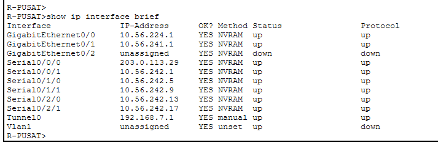


**`show ip interface brief` R-UTARA**                                      
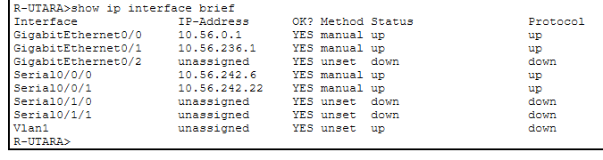


**`ipconfig` salah satu PC dengan IP statis**                                      
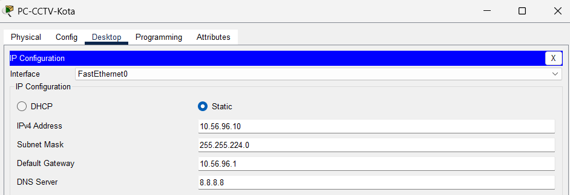


**`ping` dari PC ke gateway LAN-nya**                                      
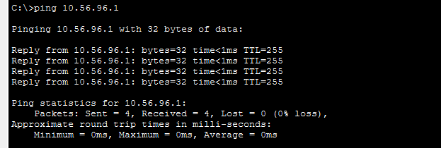


**Laptop WiFi tersambung ke AP lokasinya**                                      
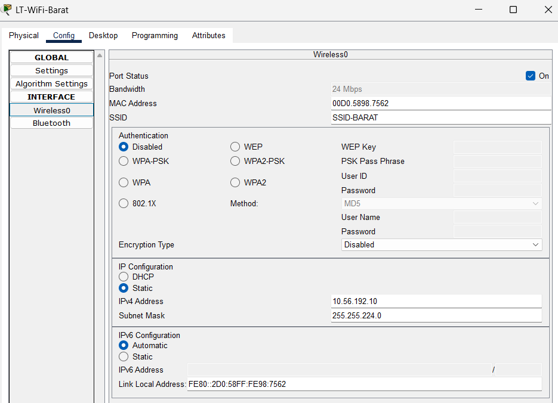


---

# Soal 3 — Static Routing

## 3.1 Ketentuan

1. Seluruh LAN saling berkomunikasi hanya dengan static route dan default route.
2. Default route hanya boleh mengarah ke router di atasnya atau keluar (R-DC ke R-PUSAT, R-PELABUHAN ke R-UTARA, R-PUSAT ke R-ISP).
3. R-PUSAT wajib punya static route ke semua LAN milik R-DC, R-UTARA, R-PELABUHAN, R-SELATAN, R-TIMUR, R-BARAT.
4. R-UTARA wajib punya static route ke semua LAN milik R-PELABUHAN.

## 3.2 Rancangan

Topologi berbentuk bintang, sehingga semua jalur antar-cabang pasti lewat R-PUSAT.

| Router | Peran | Isi tabel routing |
|---|---|---|
| R-DC, R-BARAT, R-TIMUR, R-SELATAN, R-PELABUHAN | Router ujung | 1 default route ke atas |
| R-UTARA | Ujung sekaligus transit ke R-PELABUHAN | 1 default ke R-PUSAT dan 2 static ke LAN Pelabuhan |
| R-PUSAT | Pusat bintang | 1 default ke R-ISP dan 12 static ke dalam |
| R-ISP | Internet | Tidak ada rute ke privat (syarat Soal 5) |

Next-hop adalah IP serial router tetangga pada link yang sama. LAN milik R-PUSAT sendiri tidak butuh static route karena connected langsung.

| Router | Default route | Via |
|---|---|---|
| R-PUSAT | `0.0.0.0 0.0.0.0 203.0.113.30` | R-ISP |
| R-DC | `0.0.0.0 0.0.0.0 10.56.242.1` | R-PUSAT (L1) |
| R-BARAT | `0.0.0.0 0.0.0.0 10.56.242.17` | R-PUSAT (L5) |
| R-TIMUR | `0.0.0.0 0.0.0.0 10.56.242.13` | R-PUSAT (L4) |
| R-SELATAN | `0.0.0.0 0.0.0.0 10.56.242.9` | R-PUSAT (L3) |
| R-UTARA | `0.0.0.0 0.0.0.0 10.56.242.5` | R-PUSAT (L2) |
| R-PELABUHAN | `0.0.0.0 0.0.0.0 10.56.242.22` | R-UTARA (L6) |

| Static di R-PUSAT: tujuan | Mask | Next hop | LAN |
|---|---|---|---|
| 10.56.96.0 | 255.255.224.0 | 10.56.242.2 (R-DC) | CCTV Kota |
| 10.56.239.0 | 255.255.255.0 | 10.56.242.2 (R-DC) | Server dan Storage DC |
| 10.56.0.0 | 255.255.192.0 | 10.56.242.6 (R-UTARA) | WiFi Utara |
| 10.56.236.0 | 255.255.254.0 | 10.56.242.6 (R-UTARA) | Sensor Lalu Lintas |
| 10.56.160.0 | 255.255.224.0 | 10.56.242.6 (R-UTARA) | SCADA Pelabuhan |
| 10.56.240.0 | 255.255.255.128 | 10.56.242.6 (R-UTARA) | Kantor Pelabuhan |
| 10.56.64.0 | 255.255.224.0 | 10.56.242.10 (R-SELATAN) | WiFi Selatan |
| 10.56.240.128 | 255.255.255.128 | 10.56.242.10 (R-SELATAN) | PJU Selatan |
| 10.56.128.0 | 255.255.224.0 | 10.56.242.14 (R-TIMUR) | WiFi Timur |
| 10.56.232.0 | 255.255.252.0 | 10.56.242.14 (R-TIMUR) | Sensor Banjir |
| 10.56.192.0 | 255.255.224.0 | 10.56.242.18 (R-BARAT) | WiFi Barat |
| 10.56.238.0 | 255.255.255.0 | 10.56.242.18 (R-BARAT) | Puskesmas dan Sekolah |

LAN Pelabuhan diarahkan ke R-UTARA karena R-PELABUHAN hanya terhubung lewat R-UTARA. Di R-UTARA, LAN Pelabuhan (`10.56.160.0/19` dan `10.56.240.0/25`) diarahkan ke `10.56.242.21` (R-PELABUHAN).

## 3.3 Konfigurasi

**R-PUSAT**
```
configure terminal
ip route 0.0.0.0 0.0.0.0 203.0.113.30
ip route 10.56.96.0 255.255.224.0 10.56.242.2
ip route 10.56.239.0 255.255.255.0 10.56.242.2
ip route 10.56.0.0 255.255.192.0 10.56.242.6
ip route 10.56.236.0 255.255.254.0 10.56.242.6
ip route 10.56.160.0 255.255.224.0 10.56.242.6
ip route 10.56.240.0 255.255.255.128 10.56.242.6
ip route 10.56.64.0 255.255.224.0 10.56.242.10
ip route 10.56.240.128 255.255.255.128 10.56.242.10
ip route 10.56.128.0 255.255.224.0 10.56.242.14
ip route 10.56.232.0 255.255.252.0 10.56.242.14
ip route 10.56.192.0 255.255.224.0 10.56.242.18
ip route 10.56.238.0 255.255.255.0 10.56.242.18
end
write memory
```

**R-UTARA**
```
configure terminal
ip route 0.0.0.0 0.0.0.0 10.56.242.5
ip route 10.56.160.0 255.255.224.0 10.56.242.21
ip route 10.56.240.0 255.255.255.128 10.56.242.21
end
write memory
```

**R-DC, R-BARAT, R-TIMUR, R-SELATAN, R-PELABUHAN** (masing-masing satu default route, nilai pada tabel 3.2):
```
configure terminal
ip route 0.0.0.0 0.0.0.0 <next-hop atas>
end
write memory
```

R-ISP tidak dikonfigurasi routing sama sekali. Rute salah dihapus dengan awalan `no`, misalnya `no ip route 10.56.96.0 255.255.224.0 10.56.242.2`.

## 3.4 Bukti pengujian

Hasil yang diharapkan di R-PUSAT (`show ip route static`) adalah 12 entri `S` ditambah `S* 0.0.0.0/0 via 203.0.113.30`. Router cabang cukup memiliki satu baris `S*` (R-UTARA tambah 2 entri via `10.56.242.21`). Ping pertama ke tujuan baru dapat timeout karena ARP, ulangi sekali.

| Dari | Ping ke | Jalur yang diuji |
|---|---|---|
| PC-Pegawai-BalaiKota | 10.56.160.10 | PUSAT, UTARA, PELABUHAN |
| PC-Kantor-Plb | 10.56.224.10 | PELABUHAN, UTARA, PUSAT |
| LT-WiFi-Barat | 10.56.241.10 | BARAT, PUSAT |
| PC-CCTV-Kota | 10.56.64.10 | DC, PUSAT, SELATAN |
| PC-Sensor-Banjir-Timur | 10.56.238.10 | TIMUR, PUSAT, BARAT |
| LT-WiFi-Utara | 10.56.96.10 | UTARA, PUSAT, DC |
| PC-PJU-Selatan | 10.56.239.10 | SELATAN, PUSAT, DC |
| PC-Puskesmas-Barat | 10.56.232.10 | BARAT, PUSAT, TIMUR |

Ping ke `8.8.8.8` memang belum berhasil pada tahap ini karena R-ISP sengaja tidak punya rute balik ke alamat privat. Jalur internet baru bekerja setelah NAT (Soal 5).

**`show ip route static` di R-PUSAT**                                      
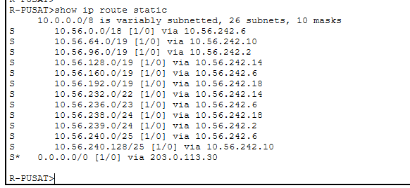


**`show ip route` di R-UTARA (default dan 2 static ke Pelabuhan)**                                      
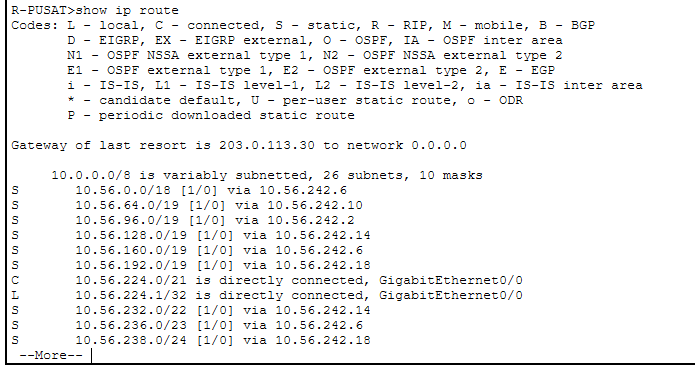


**`show ip route` di R-PELABUHAN (default via 10.56.242.22)**                                      
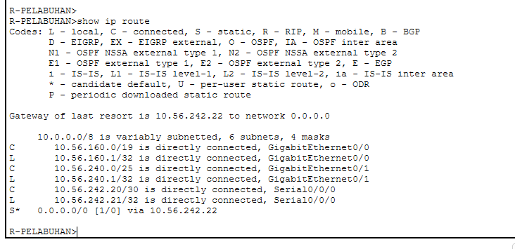


**Ping PC-Pegawai-BalaiKota ke 10.56.160.10 (jalur terdalam)**                                      
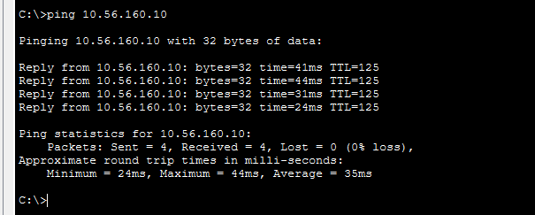


**Ping PC-Kantor-Plb ke 10.56.224.10**                                      
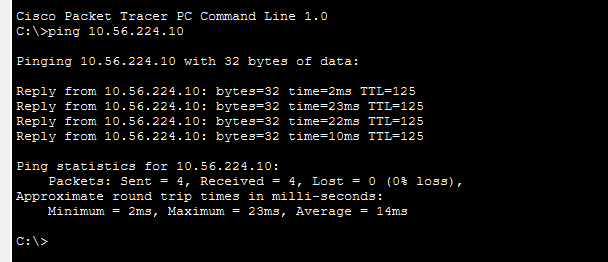


**`show ip protocols` kosong, bukti murni static**                                      
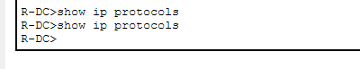


---

# Soal 4 — DHCP

## 4.1 Ketentuan

- Interface router dan seluruh server memakai IP statis.
- Perangkat pengguna mendapat IP dinamis lengkap dengan gateway dan DNS, tanpa bentrok dengan IP statis.
- Khusus subnet CCTV Kota (R-DC) dilayani server DHCP di LAN Server dan Storage DC, bukan dari router.

## 4.2 Rancangan

Satu server DHCP, **SRV-Storage-DC (`10.56.239.10`)**, melayani **12 LAN pengguna**. Dua LAN server tetap statis. Karena server DHCP berbeda subnet dari sebagian besar klien dan broadcast tidak melewati router, router LAN pengguna meneruskan permintaan lewat `ip helper-address`.

| Keputusan | Alasan |
|---|---|
| Satu server DHCP terpusat | Pool dikelola di satu tempat dan sesuai syarat CCTV |
| `ip helper-address 10.56.239.10` | Mengubah broadcast DHCP menjadi unicast ke server di subnet lain |
| Awal lease `.11` | `.1` gateway dan `.10` perwakilan statis, sehingga tidak bentrok |
| Pool PJU mulai `.139` | Perwakilan statis PJU adalah `.138`, gateway `.129` |
| Max Users realistis | Batasan simulator; subnet tetap dihitung dari host penuh |
| R-DC tetap memakai helper untuk CCTV | Server berada di subnet lain (Gig0/1) pada router yang sama |
| DNS pool `10.56.239.10` | Klien dapat meresolve `*.k7.smartcity.lab` |

## 4.3 Konfigurasi

### a. Pool di SRV-Storage-DC

**Services, DHCP, Service On.** Pool pertama menggantikan `serverPool` (tombol Save), pool lain memakai Add. TFTP Server dan WLC Address tetap `0.0.0.0`.

| No | Pool Name | Default Gateway | DNS Server | Start IP | Subnet Mask | Max Users |
|:-:|---|---|---|---|---|:-:|
| 1 | Pegawai-BK | 10.56.224.1 | 10.56.239.10 | 10.56.224.11 | 255.255.248.0 | 1000 |
| 2 | CCTV | 10.56.96.1 | 10.56.239.10 | 10.56.96.11 | 255.255.224.0 | 500 |
| 3 | WiFi-Utara | 10.56.0.1 | 10.56.239.10 | 10.56.0.11 | 255.255.192.0 | 500 |
| 4 | Sensor-Lalin | 10.56.236.1 | 10.56.239.10 | 10.56.236.11 | 255.255.254.0 | 400 |
| 5 | WiFi-Barat | 10.56.192.1 | 10.56.239.10 | 10.56.192.11 | 255.255.224.0 | 500 |
| 6 | Puskesmas | 10.56.238.1 | 10.56.239.10 | 10.56.238.11 | 255.255.255.0 | 200 |
| 7 | WiFi-Timur | 10.56.128.1 | 10.56.239.10 | 10.56.128.11 | 255.255.224.0 | 500 |
| 8 | Sensor-Banjir | 10.56.232.1 | 10.56.239.10 | 10.56.232.11 | 255.255.252.0 | 600 |
| 9 | WiFi-Selatan | 10.56.64.1 | 10.56.239.10 | 10.56.64.11 | 255.255.224.0 | 500 |
| 10 | PJU | 10.56.240.129 | 10.56.239.10 | 10.56.240.139 | 255.255.255.128 | 80 |
| 11 | SCADA-Plb | 10.56.160.1 | 10.56.239.10 | 10.56.160.11 | 255.255.224.0 | 500 |
| 12 | Kantor-Plb | 10.56.240.1 | 10.56.239.10 | 10.56.240.11 | 255.255.255.128 | 100 |

### b. Helper-address di router

**R-PUSAT dan R-DC** (satu interface):
```
enable
configure terminal
interface GigabitEthernet0/0
 ip helper-address 10.56.239.10
end
write memory
```

**R-UTARA, R-BARAT, R-TIMUR, R-SELATAN, R-PELABUHAN** (dua interface):
```
enable
configure terminal
interface GigabitEthernet0/0
 ip helper-address 10.56.239.10
exit
interface GigabitEthernet0/1
 ip helper-address 10.56.239.10
end
write memory
```

R-ISP tidak dikonfigurasi karena tidak memiliki LAN pengguna.

### c. Klien

12 PC dan laptop diubah ke DHCP (**Desktop, IP Configuration, DHCP**). SRV-BalaiKota, SRV-Storage-DC, dan SRV-Internet tetap statis.

## 4.4 Bukti pengujian

Nomor host yang didapat tidak selalu `.11`. DHCP memberi alamat bebas berikutnya dari pool, selama masih dalam subnet dan tidak bentrok dengan IP statis. 

**Daftar 12 pool DHCP di SRV-Storage-DC**                                      
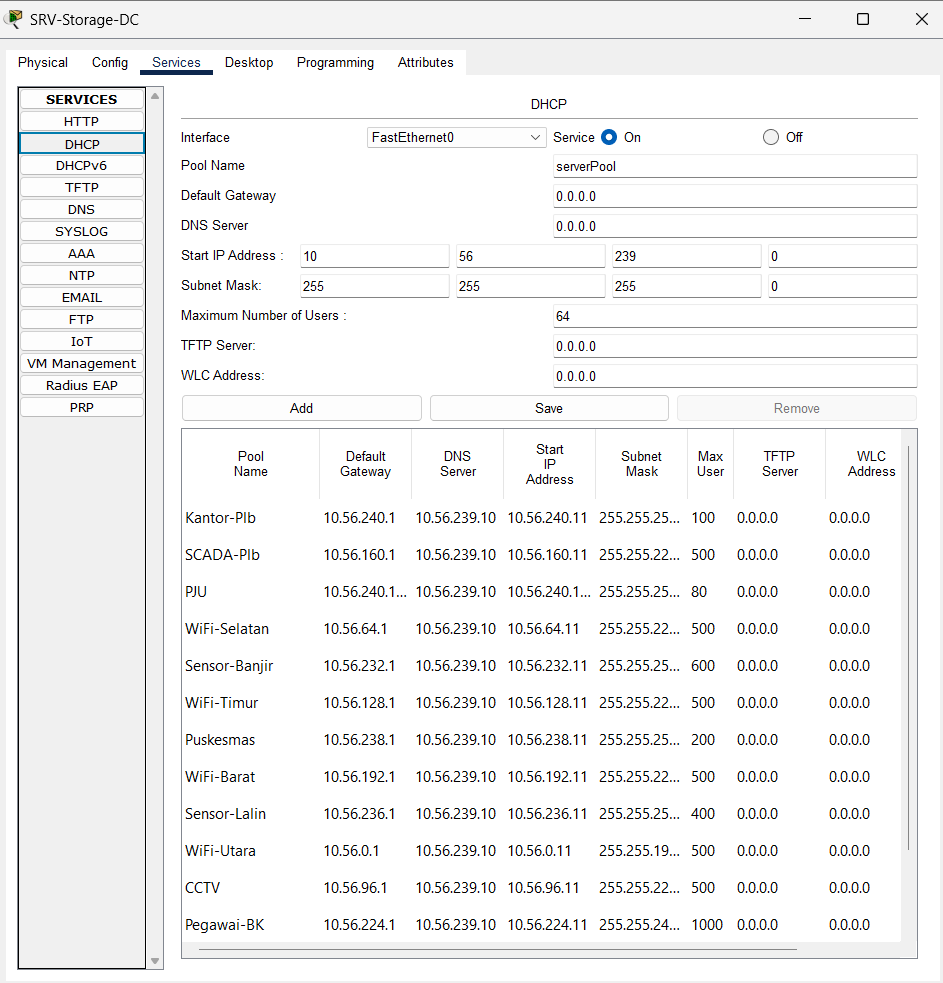


**`show running-config | include helper` di R-PUSAT**                                      
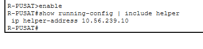


**`show running-config | include helper` di R-DC**                                      
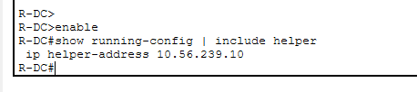


**`show running-config | include helper` di R-UTARA**                                      
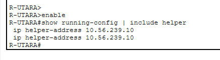

**`ipconfig` PC-CCTV-Kota**                                      
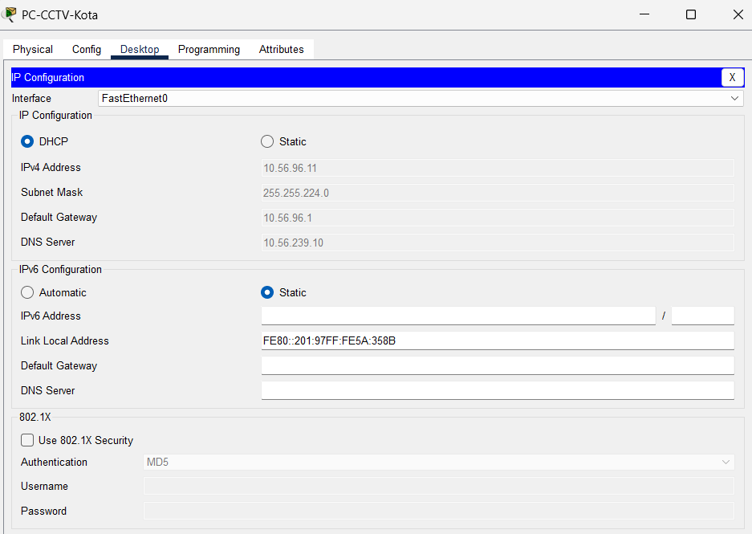


**Ping PC-CCTV-Kota ke 10.56.239.10**                                      
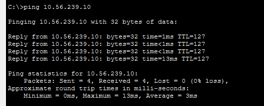


**`ipconfig` PC-Pegawai-BalaiKota**                                      
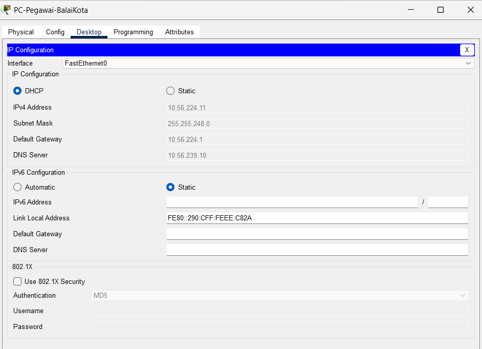


**`ipconfig` LT-WiFi-Utara**                                      
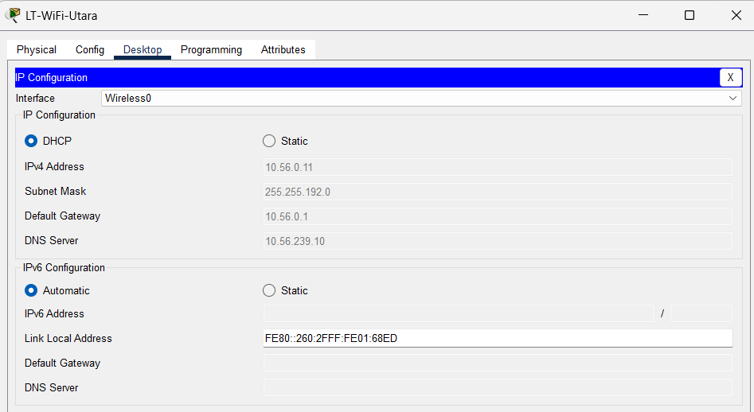


**`ipconfig` LT-WiFi-Barat**                                      
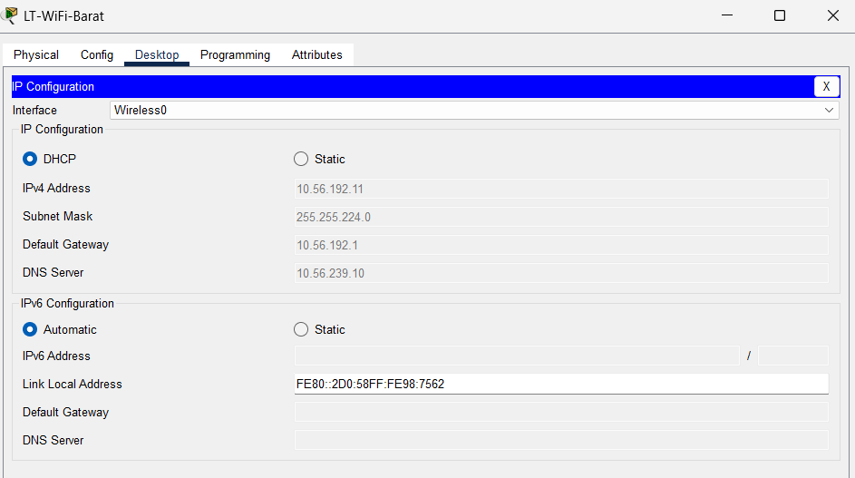


**`ipconfig` PC-PJU-Selata**                                      
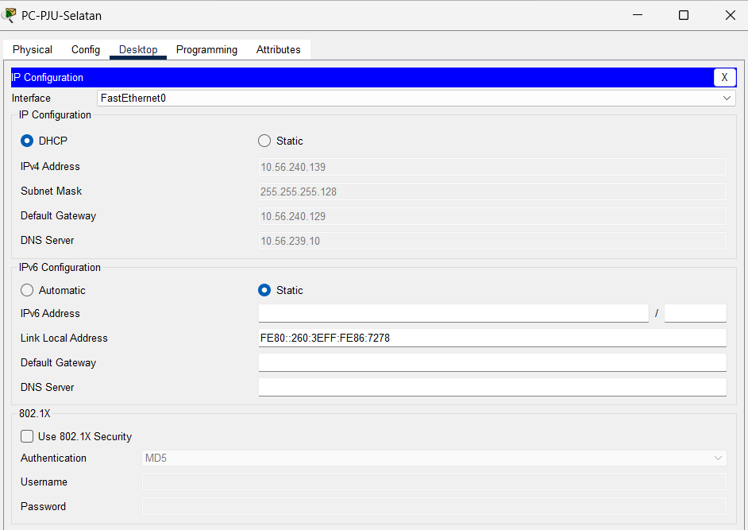


**`ipconfig` PC-Kantor-Plb**                                      
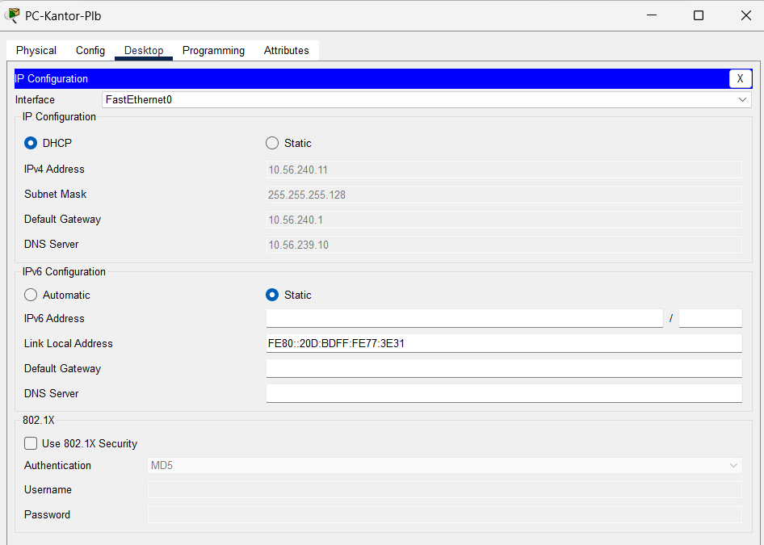


| Perangkat | Subnet | IP dari DHCP |
|---|---|---|
| PC-CCTV-Kota | 10.56.96.0/19 | 10.56.96.11 |
| PC-Pegawai-BalaiKota | 10.56.224.0/21 | 10.56.224.11 |
| LT-WiFi-Utara | 10.56.0.0/18 | 10.56.0.11 |
| PC-Sensor-Lalin-Utara | 10.56.236.0/23 | 10.56.236.11 |
| LT-WiFi-Barat | 10.56.192.0/19 | 10.56.192.11 |
| PC-Puskesmas-Barat | 10.56.238.0/24 | 10.56.238.11 |
| LT-WiFi-Timur | 10.56.128.0/19 | 10.56.128.11 |
| PC-Sensor-Banjir-Timur | 10.56.232.0/22 | 10.56.232.11 |
| LT-WiFi-Selatan | 10.56.64.0/19 | 10.56.64.11 |
| PC-PJU-Selatan | 10.56.240.128/25 | 10.56.240.139 |
| PC-SCADA-Plb | 10.56.160.0/19 | 10.56.160.11 |
| PC-Kantor-Plb | 10.56.240.0/25 | 10.56.240.11 |

`ip helper-address` dipasang di interface LAN, sehingga tidak terpengaruh protokol routing. Pada file OSPF, `passive-interface` hanya menghentikan pesan OSPF ke LAN dan tidak menghentikan relay DHCP.

---

# Soal 5 — NAT

## 5.1 Ketentuan

- Seluruh host dapat mengakses server `8.8.8.8` memakai satu IP publik milik R-PUSAT.
- R-ISP tidak boleh memiliki rute ke alamat privat internal.

## 5.2 Rancangan

Alamat privat `10.56.x.x` tidak dapat dirutekan di internet, dan R-ISP sengaja tidak punya rute ke sana. Solusinya **PAT (NAT overload)** di R-PUSAT: alamat asal paket diganti IP publik R-PUSAT `203.0.113.29`. Banyak host berbagi satu IP publik karena dibedakan nomor port.

| Elemen | Nilai |
|---|---|
| IP publik | `203.0.113.29` (Serial0/0/0 R-PUSAT) |
| Interface outside | `Serial0/0/0` |
| Interface inside | `Gig0/0`, `Gig0/1`, `Serial0/0/1`, `Serial0/1/0`, `Serial0/1/1`, `Serial0/2/0`, `Serial0/2/1` |
| Alamat yang di-NAT | ACL 1: `10.56.0.0/16` |
| Jenis | PAT / overload |

## 5.3 Konfigurasi (di R-PUSAT)

```
enable
configure terminal
access-list 1 permit 10.56.0.0 0.0.255.255
interface GigabitEthernet0/0
 ip nat inside
interface GigabitEthernet0/1
 ip nat inside
interface Serial0/0/1
 ip nat inside
interface Serial0/1/0
 ip nat inside
interface Serial0/1/1
 ip nat inside
interface Serial0/2/0
 ip nat inside
interface Serial0/2/1
 ip nat inside
interface Serial0/0/0
 ip nat outside
exit
ip nat inside source list 1 interface Serial0/0/0 overload
end
write memory
```

| Perintah | Artinya |
|---|---|
| `access-list 1 permit 10.56.0.0 0.0.255.255` | Alamat yang berhak di-NAT: seluruh `10.56.x.x` (wildcard mask) |
| `ip nat inside` / `ip nat outside` | Menandai sisi dalam dan sisi menghadap internet |
| `ip nat inside source list 1 interface Serial0/0/0 overload` | Mengganti alamat asal menjadi IP `Serial0/0/0`; `overload` membagi satu IP ke banyak host lewat port |

R-ISP tidak dikonfigurasi apa pun. R-ISP hanya melihat `203.0.113.29`, tidak pernah melihat `10.56.x.x`.

## 5.4 Bukti pengujian

| Uji | Hasil |
|---|---|
| `ping 8.8.8.8` dari PC-Pegawai-BalaiKota | Reply (ping pertama dapat timeout karena ARP) |
| `ping 8.8.8.8` dari PC-Kantor-Plb | Reply |
| `show ip nat translations` di R-PUSAT | Beberapa baris `203.0.113.29:x` ke `10.56.x.x:x` dengan tujuan `8.8.8.8` |
| `show ip route` di R-ISP | Hanya rute connected, tanpa rute `10.x` |

Tabel translasi membuktikan host dari lokasi berbeda keluar dengan satu IP publik yang sama dan port berbeda.

**Konfigurasi NAT di R-PUSAT (`show running-config` bagian NAT)**                                      
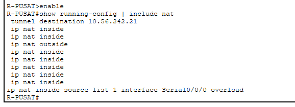


**Ping 8.8.8.8 dari PC Balai Kota**                                      
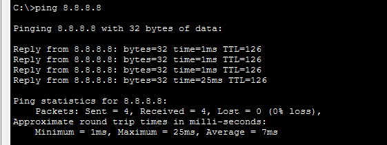


**Ping 8.8.8.8 dari PC Pelabuhan**                                      
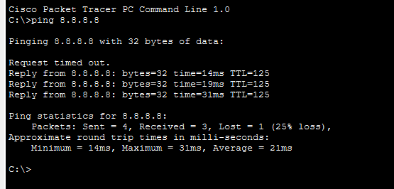


**`show ip nat translations` di R-PUSAT**                                      
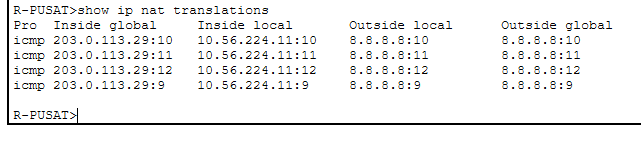


**`show ip route` di R-ISP**                                      
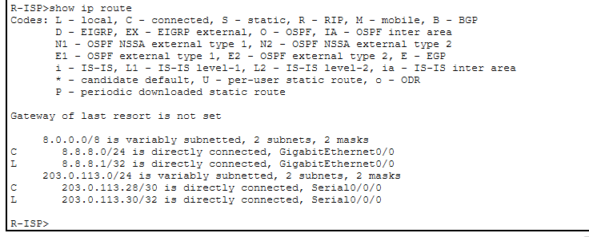

---

# Soal 6 — Tunnel GRE (Bonus IPsec)

## 6.1 Ketentuan

- Tunnel GRE antara R-PUSAT dan R-PELABUHAN pada `192.168.7.0/30` (R-PUSAT `.1`, R-PELABUHAN `.2`).
- Lalu lintas antara subnet Balai Kota dan subnet Pelabuhan harus lewat tunnel.
- Jelaskan alasan router memilih jalur tunnel dan alasan GRE saja tidak mengenkripsi data.
- Bonus (+5): trafik di dalam tunnel dienkripsi dengan IPsec.

## 6.2 Rancangan

Tunnel menumpang jalur fisik R-PUSAT, L2, R-UTARA, L6, R-PELABUHAN. R-UTARA hanya meneruskan paket dan tidak ikut tunnel.

| Elemen | R-PUSAT | R-PELABUHAN |
|---|---|---|
| IP tunnel | `192.168.7.1/30` | `192.168.7.2/30` |
| Tunnel source | `Serial0/1/0` (`10.56.242.5`) | `Serial0/0/0` (`10.56.242.21`) |
| Tunnel destination | `10.56.242.21` | `10.56.242.5` |

`tunnel destination` adalah IP serial ujung lawan tunnel, **bukan** IP R-UTARA. R-PUSAT juga butuh rute ke link L6 (`10.56.242.20/30`) lewat R-UTARA agar paket GRE tidak masuk ke default route (menuju R-ISP).

## 6.3 Konfigurasi

**R-PUSAT**
```
enable
configure terminal
ip route 10.56.242.20 255.255.255.252 10.56.242.6
interface Tunnel0
 ip address 192.168.7.1 255.255.255.252
 tunnel source Serial0/1/0
 tunnel destination 10.56.242.21
 no shutdown
exit
no ip route 10.56.160.0 255.255.224.0 10.56.242.6
no ip route 10.56.240.0 255.255.255.128 10.56.242.6
ip route 10.56.160.0 255.255.224.0 192.168.7.2
ip route 10.56.240.0 255.255.255.128 192.168.7.2
end
write memory
```

**R-PELABUHAN**
```
enable
configure terminal
interface Tunnel0
 ip address 192.168.7.2 255.255.255.252
 tunnel source Serial0/0/0
 tunnel destination 10.56.242.5
 no shutdown
exit
ip route 10.56.224.0 255.255.248.0 192.168.7.1
ip route 10.56.241.0 255.255.255.224 192.168.7.1
end
write memory
```

R-UTARA tidak perlu konfigurasi tambahan.

## 6.4 Bukti pengujian

| Uji | Hasil |
|---|---|
| `ping 192.168.7.2` dari R-PUSAT | 100 persen |
| `show interfaces Tunnel0` di R-PUSAT | up/up, source `10.56.242.5`, destination `10.56.242.21`, protokol GRE/IP |
| `tracert 10.56.160.10` dari PC-Pegawai-BalaiKota | Hop 1 `10.56.224.1`, hop 2 `192.168.7.2`, hop 3 tujuan |
| Ping Balai Kota ke Pelabuhan dan sebaliknya | 100 persen reply |
| Ping `8.8.8.8` dari PC Pelabuhan | Tetap berhasil |

Bukti terbaik tunnel dipakai adalah traceroute: hop `192.168.7.2` muncul setelah gateway Balai Kota.

**Konfigurasi Tunnel0 di R-PUSAT dan R-PELABUHAN**                                      
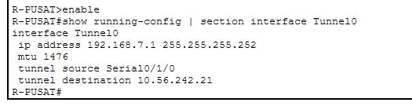
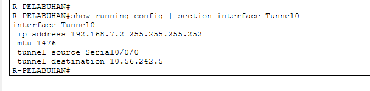


**`ping 192.168.7.2` dari R-PUSAT**                                      
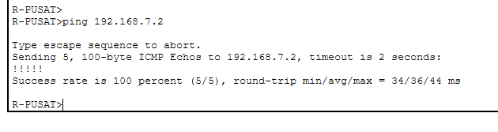


**`show interfaces Tunnel0`**                                      
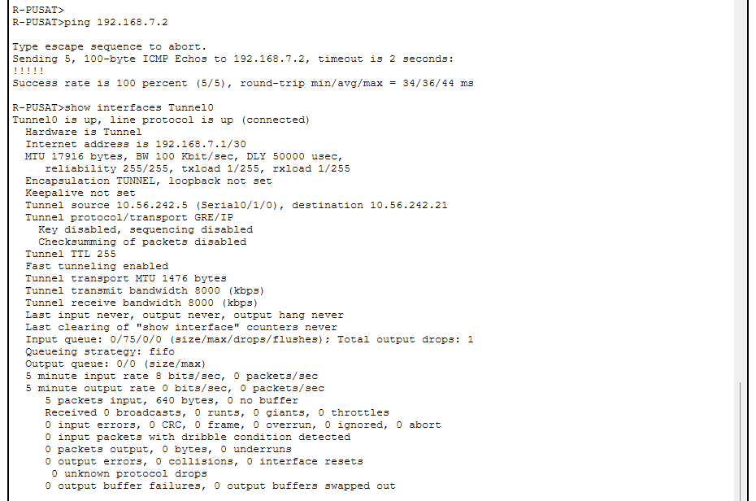


**`tracert` Balai Kota ke Pelabuhan (hop 192.168.7.2)**                                      
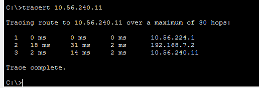


**`tracert` Pelabuhan ke Balai Kota (hop 192.168.7.1)**                                      
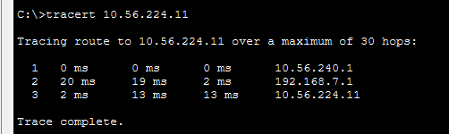

## 6.5 Penjelasan teknis

**Mengapa router memilih jalur tunnel.** Router memilih berdasarkan prefix paling spesifik (longest prefix match), baru administrative distance dan metric. Di R-PUSAT rute ke LAN Pelabuhan dipasang dengan next-hop `192.168.7.2` dan rute lama via R-UTARA dihapus, sehingga satu-satunya rute ke Pelabuhan adalah lewat `Tunnel0`. Di R-PELABUHAN, rute ke LAN Balai Kota (`10.56.224.0/21`, `10.56.241.0/27`) lebih spesifik daripada default route, sehingga rute tunnel yang menang. Paket yang masuk `Tunnel0` dibungkus header GRE baru `10.56.242.5` ke `10.56.242.21` lalu dikirim lewat jalur fisik biasa. Jalur fisik di bawahnya sama; yang berubah adalah cara paket dibawa. Manfaatnya: kedua LAN terhubung seperti satu hop langsung secara logis, trafik terisolasi dari isi tabel R-UTARA, dan tunnel menjadi dasar enkripsi IPsec.

**Mengapa GRE saja tidak mengenkripsi.** GRE hanya enkapsulasi: paket asli dibungkus header GRE dan IP baru agar dapat melewati jaringan lain. Bungkusan itu tidak diacak, tidak ditandatangani, dan tidak diautentikasi. Penyadap di tengah jalur (misalnya di R-UTARA) dapat membaca isi paket aslinya. Jadi GRE tidak memberi kerahasiaan, integritas, maupun autentikasi, dan perlu dikombinasikan dengan IPsec.

## 6.6 Bonus: IPsec di atas GRE

Aktifkan lisensi di R-PUSAT dan R-PELABUHAN:
```
enable
configure terminal
license boot module c2900 technology-package securityk9
```
Jawab `yes` pada `ACCEPT? [yes/no]`, lalu `end`, `write memory`, `reload` (tekan Enter saja pada konfirmasi). Setelah menyala, `show version` harus menampilkan `securityk9`.

**R-PUSAT**
```
enable
configure terminal
crypto isakmp policy 10
 encryption aes 256
 hash sha
 authentication pre-share
 group 5
exit
crypto isakmp key SMARTCITY7 address 10.56.242.21
crypto ipsec transform-set TS-GRE esp-aes 256 esp-sha-hmac
ip access-list extended ACL-VPN
 permit gre host 10.56.242.5 host 10.56.242.21
exit
crypto map CM-VPN 10 ipsec-isakmp
 set peer 10.56.242.21
 set transform-set TS-GRE
 match address ACL-VPN
exit
interface Serial0/1/0
 crypto map CM-VPN
end
write memory
```

**R-PELABUHAN**
```
enable
configure terminal
crypto isakmp policy 10
 encryption aes 256
 hash sha
 authentication pre-share
 group 5
exit
crypto isakmp key SMARTCITY7 address 10.56.242.5
crypto ipsec transform-set TS-GRE esp-aes 256 esp-sha-hmac
ip access-list extended ACL-VPN
 permit gre host 10.56.242.21 host 10.56.242.5
exit
crypto map CM-VPN 10 ipsec-isakmp
 set peer 10.56.242.5
 set transform-set TS-GRE
 match address ACL-VPN
exit
interface Serial0/0/0
 crypto map CM-VPN
end
write memory
```

| Bagian | Fungsi |
|---|---|
| `crypto isakmp policy 10` | Fase 1: AES-256, SHA, pre-shared key, Diffie-Hellman grup 5 |
| `crypto isakmp key` | Kata sandi bersama, harus sama di kedua router |
| `transform-set TS-GRE` | Fase 2: ESP AES-256 dengan SHA-HMAC |
| `ACL-VPN` | Trafik yang dienkripsi: paket GRE antara dua ujung tunnel |
| `crypto map` pada serial | Menerapkan kebijakan di interface keluar menuju R-UTARA |

Perintah `crypto` hanya dikenali di mode `(config)#`. Setelah `transform-set` tidak boleh ada `exit`.

| Uji | Hasil |
|---|---|
| `show crypto isakmp sa` | State `QM_IDLE`, status `ACTIVE` |
| `show crypto ipsec sa` | Protokol 47 (GRE), `#pkts encrypt` dan `#pkts decrypt` naik |
| `tracert 10.56.160.10` | Tetap menampilkan `192.168.7.2` |

**`show version` lisensi securityk9**                                      
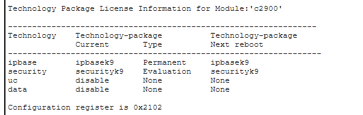

**Konfigurasi crypto di R-PUSAT dan R-PELABUHAN**                                      
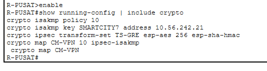
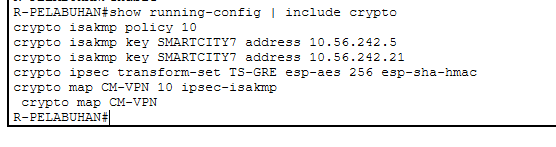

**`show crypto isakmp sa` (QM_IDLE)**                                      
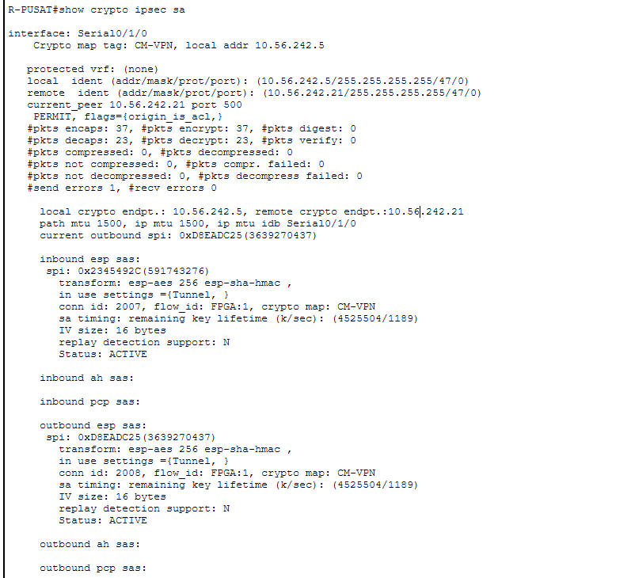


**`show crypto ipsec sa` (encaps dan decaps)**                                      
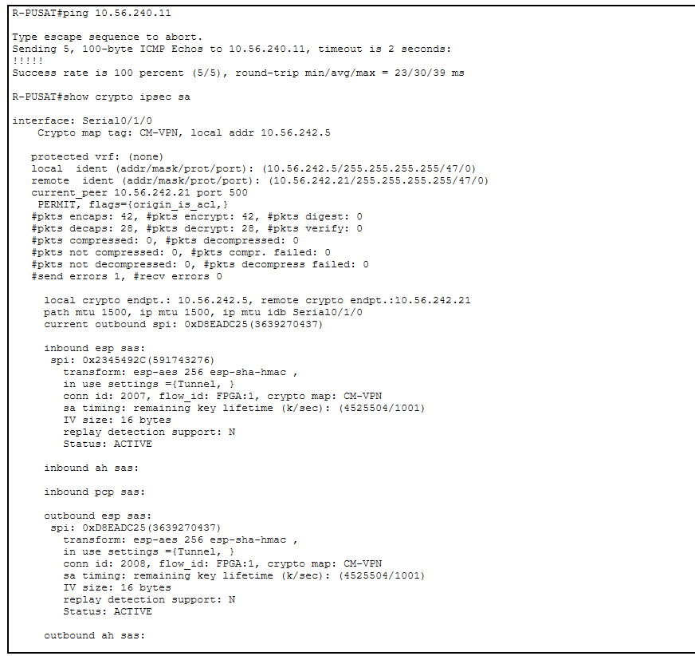


---

# Soal 7 — Dynamic Routing OSPF

## 7.1 Ketentuan

- Dikerjakan di file terpisah (salinan file utama), yaitu `K7_VLSM_OSPF.pkt`.
- Tambahkan link cadangan L7 antara R-DC dan R-UTARA dengan alamat yang belum terpakai.
- Ganti seluruh static route antar-router dengan OSPF. Router tidak mengirim pesan OSPF ke LAN pengguna. Default route ke internet hanya di R-PUSAT, router lain mendapatkannya lewat OSPF.
- Jika satu link backbone putus, konektivitas pulih otomatis lewat jalur lain.

## 7.2 Rancangan

OSPF proses 1, single area 0. R-ISP di luar OSPF.

| Link | R-DC | R-UTARA | Subnet |
|---|---|---|---|
| L7 | `Serial0/0/1` = `10.56.242.25` (DCE) | `Serial0/1/0` = `10.56.242.26` | `10.56.242.24/30` |

| Router | Router-ID | Network (area 0) |
|---|---|---|
| R-PUSAT | 7.7.7.1 | `10.56.224.0 0.0.7.255`, `10.56.241.0 0.0.0.31`, `10.56.242.0`, `.4`, `.8`, `.12`, `.16` (masing-masing `0.0.0.3`) |
| R-UTARA | 7.7.7.2 | `10.56.0.0 0.0.63.255`, `10.56.236.0 0.0.1.255`, `10.56.242.4`, `.20`, `.24` (`0.0.0.3`) |
| R-DC | 7.7.7.3 | `10.56.96.0 0.0.31.255`, `10.56.239.0 0.0.0.255`, `10.56.242.0`, `.24` (`0.0.0.3`) |
| R-BARAT | 7.7.7.4 | `10.56.192.0 0.0.31.255`, `10.56.238.0 0.0.0.255`, `10.56.242.16 0.0.0.3` |
| R-TIMUR | 7.7.7.5 | `10.56.128.0 0.0.31.255`, `10.56.232.0 0.0.3.255`, `10.56.242.12 0.0.0.3` |
| R-SELATAN | 7.7.7.6 | `10.56.64.0 0.0.31.255`, `10.56.240.128 0.0.0.127`, `10.56.242.8 0.0.0.3` |
| R-PELABUHAN | 7.7.7.7 | `10.56.160.0 0.0.31.255`, `10.56.240.0 0.0.0.127`, `10.56.242.20 0.0.0.3` |

Semua interface LAN (Gig0/0 dan Gig0/1) di 7 router dijadikan `passive-interface`.

## 7.3 Konfigurasi

### a. Link L7

Pasang kabel Serial DCE: klik R-DC `Serial0/0/1` dahulu, lalu R-UTARA `Serial0/1/0`.

**R-DC**
```
enable
configure terminal
interface Serial0/0/1
 ip address 10.56.242.25 255.255.255.252
 clock rate 2000000
 no shutdown
end
write memory
```
**R-UTARA**
```
enable
configure terminal
interface Serial0/1/0
 ip address 10.56.242.26 255.255.255.252
 no shutdown
end
write memory
```

### b. OSPF

**R-PUSAT** (hanya di sini ada `default-information originate`)
```
enable
configure terminal
router ospf 1
 router-id 7.7.7.1
 network 10.56.224.0 0.0.7.255 area 0
 network 10.56.241.0 0.0.0.31 area 0
 network 10.56.242.0 0.0.0.3 area 0
 network 10.56.242.4 0.0.0.3 area 0
 network 10.56.242.8 0.0.0.3 area 0
 network 10.56.242.12 0.0.0.3 area 0
 network 10.56.242.16 0.0.0.3 area 0
 passive-interface GigabitEthernet0/0
 passive-interface GigabitEthernet0/1
 default-information originate
end
write memory
```
**R-UTARA**
```
enable
configure terminal
router ospf 1
 router-id 7.7.7.2
 network 10.56.0.0 0.0.63.255 area 0
 network 10.56.236.0 0.0.1.255 area 0
 network 10.56.242.4 0.0.0.3 area 0
 network 10.56.242.20 0.0.0.3 area 0
 network 10.56.242.24 0.0.0.3 area 0
 passive-interface GigabitEthernet0/0
 passive-interface GigabitEthernet0/1
end
write memory
```
**R-DC**
```
enable
configure terminal
router ospf 1
 router-id 7.7.7.3
 network 10.56.96.0 0.0.31.255 area 0
 network 10.56.239.0 0.0.0.255 area 0
 network 10.56.242.0 0.0.0.3 area 0
 network 10.56.242.24 0.0.0.3 area 0
 passive-interface GigabitEthernet0/0
 passive-interface GigabitEthernet0/1
end
write memory
```
**R-BARAT**
```
enable
configure terminal
router ospf 1
 router-id 7.7.7.4
 network 10.56.192.0 0.0.31.255 area 0
 network 10.56.238.0 0.0.0.255 area 0
 network 10.56.242.16 0.0.0.3 area 0
 passive-interface GigabitEthernet0/0
 passive-interface GigabitEthernet0/1
end
write memory
```
**R-TIMUR**
```
enable
configure terminal
router ospf 1
 router-id 7.7.7.5
 network 10.56.128.0 0.0.31.255 area 0
 network 10.56.232.0 0.0.3.255 area 0
 network 10.56.242.12 0.0.0.3 area 0
 passive-interface GigabitEthernet0/0
 passive-interface GigabitEthernet0/1
end
write memory
```
**R-SELATAN**
```
enable
configure terminal
router ospf 1
 router-id 7.7.7.6
 network 10.56.64.0 0.0.31.255 area 0
 network 10.56.240.128 0.0.0.127 area 0
 network 10.56.242.8 0.0.0.3 area 0
 passive-interface GigabitEthernet0/0
 passive-interface GigabitEthernet0/1
end
write memory
```
**R-PELABUHAN**
```
enable
configure terminal
router ospf 1
 router-id 7.7.7.7
 network 10.56.160.0 0.0.31.255 area 0
 network 10.56.240.0 0.0.0.127 area 0
 network 10.56.242.20 0.0.0.3 area 0
 passive-interface GigabitEthernet0/0
 passive-interface GigabitEthernet0/1
end
write memory
```

OSPF dipasang lebih dulu sebelum static route dihapus agar jaringan tetap berjalan selama proses.

### c. Menghapus static route antar-router

Default route R-PUSAT ke R-ISP (`ip route 0.0.0.0 0.0.0.0 203.0.113.30`) **dipertahankan** karena dibutuhkan untuk `default-information originate`.

**R-PUSAT**
```
configure terminal
no ip route 10.56.96.0 255.255.224.0 10.56.242.2
no ip route 10.56.239.0 255.255.255.0 10.56.242.2
no ip route 10.56.0.0 255.255.192.0 10.56.242.6
no ip route 10.56.236.0 255.255.254.0 10.56.242.6
no ip route 10.56.64.0 255.255.224.0 10.56.242.10
no ip route 10.56.240.128 255.255.255.128 10.56.242.10
no ip route 10.56.128.0 255.255.224.0 10.56.242.14
no ip route 10.56.232.0 255.255.252.0 10.56.242.14
no ip route 10.56.192.0 255.255.224.0 10.56.242.18
no ip route 10.56.238.0 255.255.255.0 10.56.242.18
no ip route 10.56.242.20 255.255.255.252 10.56.242.6
no ip route 10.56.160.0 255.255.224.0 192.168.7.2
no ip route 10.56.240.0 255.255.255.128 192.168.7.2
interface Tunnel0
 shutdown
end
write memory
```
**R-UTARA**
```
configure terminal
no ip route 0.0.0.0 0.0.0.0 10.56.242.5
no ip route 10.56.160.0 255.255.224.0 10.56.242.21
no ip route 10.56.240.0 255.255.255.128 10.56.242.21
end
write memory
```
**R-PELABUHAN**
```
configure terminal
no ip route 0.0.0.0 0.0.0.0 10.56.242.22
no ip route 10.56.224.0 255.255.248.0 192.168.7.1
no ip route 10.56.241.0 255.255.255.224 192.168.7.1
interface Tunnel0
 shutdown
end
write memory
```

| Router | Perintah penghapusan default |
|---|---|
| R-DC | `no ip route 0.0.0.0 0.0.0.0 10.56.242.1` |
| R-BARAT | `no ip route 0.0.0.0 0.0.0.0 10.56.242.17` |
| R-TIMUR | `no ip route 0.0.0.0 0.0.0.0 10.56.242.13` |
| R-SELATAN | `no ip route 0.0.0.0 0.0.0.0 10.56.242.9` |

Tunnel GRE hanya di-`shutdown`, bukan dihapus. Di file OSPF, trafik Balai Kota ke Pelabuhan berjalan lewat jalur fisik hasil OSPF karena soal meminta semua static route diganti OSPF.

## 7.4 Bukti pengujian

| Uji | Hasil |
|---|---|
| `show ip ospf neighbor` di R-PUSAT | 5 neighbor FULL |
| `show ip protocols` di R-PUSAT | OSPF 1, Router ID `7.7.7.1`, passive interface Gig0/0 dan Gig0/1 |
| `show ip route` di router cabang | Rute `O` dan `O*E2 0.0.0.0/0`, tanpa `S` |
| `show ip route static` di semua router | Kosong (R-PUSAT hanya default `S*` ke R-ISP) |
| Ping antar-LAN dan `8.8.8.8` | Berhasil |

Router lain mendapat default route `O*E2` hanya dari R-PUSAT karena hanya R-PUSAT yang memiliki `default-information originate`.

**Topologi OSPF**                                      


**`show ip ospf neighbor` di R-PUSAT**                                      
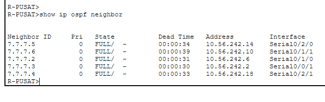

**`show ip protocols` di R-PUSAT**                                      
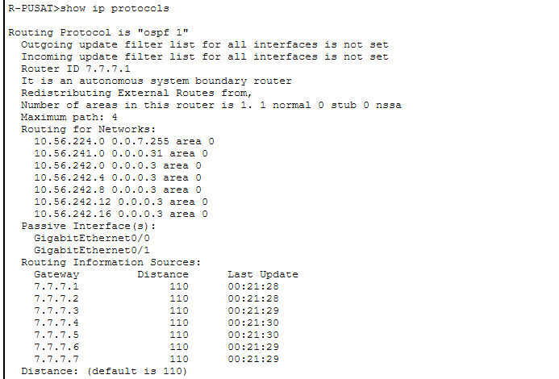


**`show ip route` di R-PELABUHAN (rute O dan O*E2)**                                      
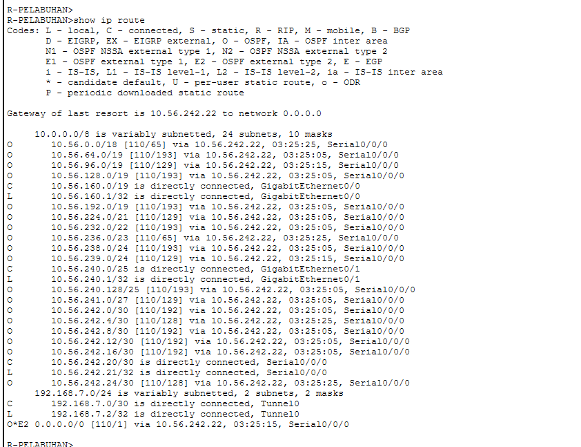


**`show ip route static` kosong di router cabang**                                      
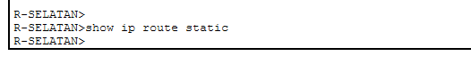


**Ping 8.8.8.8 dari PC-Kantor-Plb**                                      
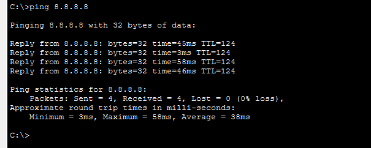


## 7.5 Uji failover

Skenario pada dokumen routing: L2 putus, jalur cadangan R-PELABUHAN, R-UTARA, L7, R-DC, R-PUSAT. Skenario pada layanan aplikasi (Soal 8, bagian 8.6): L1 putus, jalur cadangan R-PUSAT, R-UTARA, L7, R-DC.

1. Dari PC-Kantor-Plb jalankan `ping -t 10.56.224.10`.
2. Di R-UTARA: `show ip route 10.56.224.0` sebelum link putus (next-hop `10.56.242.5`, lewat L2).
3. Di R-PUSAT: `interface Serial0/1/0`, lalu `shutdown`.
4. Ping timeout sesaat, lalu pulih sendiri.
5. Di R-UTARA: `show ip route 10.56.224.0` lagi; next-hop berubah menjadi `10.56.242.25` (R-DC lewat L7).
6. Di R-PUSAT: `show ip ospf neighbor` menunjukkan 4 neighbor selama L2 mati.
7. `no shutdown`, tunggu 5 neighbor FULL dan next-hop kembali normal.

**`show ip route 10.56.224.0` di R-UTARA sebelum link putus**                                      
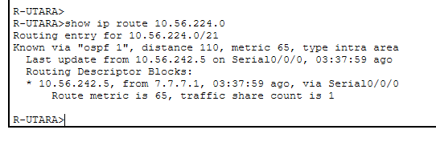


**`show ip route 10.56.224.0` di R-UTARA setelah link putus (via 10.56.242.25)**                                      
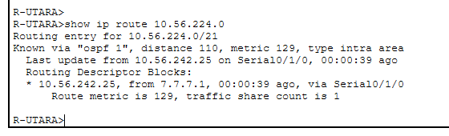


**`show ip ospf neighbor` di R-PUSAT saat L2 mati (4 neighbor)**                                      
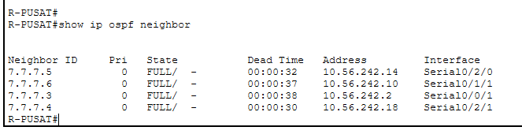

**Kondisi setelah link dihidupkan lagi (5 neighbor)**                                      
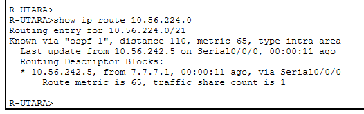
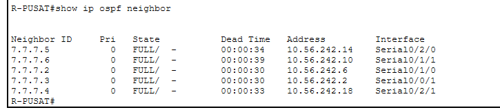


## 7.6 Pemenuhan syarat

| Syarat | Cara pemenuhan |
|---|---|
| Tidak mengirim OSPF ke LAN pengguna | `passive-interface` di semua interface LAN |
| Default route hanya di R-PUSAT | Hanya R-PUSAT yang punya static default dan `default-information originate` |
| Pulih otomatis | Link L7 menyediakan jalur alternatif, OSPF menghitung ulang saat adjacency terputus |
| Static route diganti OSPF | Semua `ip route` antar-router dihapus (kecuali default R-PUSAT ke R-ISP) |

---

# Soal 8 — Layanan Aplikasi Smart City

## 8.1 Ketentuan

Domain internal `k7.smartcity.lab`.

- **a. DNS** di LAN Server dan Storage DC; `www`, `ftp`, `mail` dapat diakses dari seluruh wilayah.
- **b. Web** di LAN Server Balai Kota berupa halaman "Portal Smart City Surabaya" yang mencantumkan nomor kelompok, dapat dibuka dengan nama domain dari semua wilayah.
- **c. FTP** di LAN Server dan Storage DC untuk penyimpanan rekaman CCTV; perangkat di LAN CCTV mengunggah file dengan akun login.
- **d. Email** antarpegawai; pengguna Balai Kota dan Pelabuhan dapat saling mengirim dan menerima.

## 8.2 Rancangan

| Layanan | Server | IP | Alasan penempatan |
|---|---|---|---|
| DNS | SRV-Storage-DC | 10.56.239.10 | Ditentukan soal; satu titik resolusi nama |
| FTP | SRV-Storage-DC | 10.56.239.10 | Ditentukan soal; penyimpanan rekaman CCTV |
| Web Portal | SRV-BalaiKota | 10.56.241.10 | Ditentukan soal; portal resmi pemerintah kota |
| Email (SMTP dan POP3) | SRV-BalaiKota | 10.56.241.10 | Email antarpegawai berpusat di Balai Kota |

Seluruh klien memakai DNS `10.56.239.10`: klien DHCP menerimanya dari pool (Soal 4), sedangkan DNS SRV-BalaiKota (statis) diubah dari `8.8.8.8` menjadi `10.56.239.10`. DNS dikerjakan lebih dulu karena layanan lain diakses lewat nama domain.

| Record DNS | Type | Address |
|---|---|---|
| www.k7.smartcity.lab | A | 10.56.241.10 |
| ftp.k7.smartcity.lab | A | 10.56.239.10 |
| mail.k7.smartcity.lab | A | 10.56.241.10 |

| Layanan | Akun | Password |
|---|---|---|
| FTP | `cctv` (Write, Read, Delete, Rename, List) | `cctv123` |
| Email | `pegawai` | `pass123` |
| Email | `pelabuhan` | `pass123` |

## 8.3 Konfigurasi

**DNS:** SRV-Storage-DC, Services, DNS, On, lalu tambah tiga A Record di atas.

**Web:** SRV-BalaiKota, Services, HTTP, On, lalu edit `index.html`:
```html
<html>
<body>
<h1>Portal Smart City Surabaya</h1>
<p>Kelompok 7</p>
</body>
</html>
```

**FTP:** SRV-Storage-DC, Services, FTP, On, tambah user `cctv` dengan password `cctv123` dan semua permission. Di PC-CCTV-Kota, buat `rekaman.txt` lewat Text Editor, lalu:
```
ftp ftp.k7.smartcity.lab
(username: cctv, password: cctv123)
put rekaman.txt
dir
quit
```

**Email:** SRV-BalaiKota, Services, EMAIL, SMTP dan POP3 On, Domain Name `k7.smartcity.lab` (Set), tambah user `pegawai` dan `pelabuhan`. Konfigurasi klien (Desktop, Email, Configure Mail):

| Kolom | PC-Pegawai-BalaiKota | PC-Kantor-Plb |
|---|---|---|
| Your Name | Pegawai | Pelabuhan |
| Email Address | pegawai@k7.smartcity.lab | pelabuhan@k7.smartcity.lab |
| Incoming / Outgoing Mail Server | mail.k7.smartcity.lab | mail.k7.smartcity.lab |
| User Name | pegawai | pelabuhan |
| Password | pass123 | pass123 |

Email dikirim dengan Compose; penerima menekan Receive.

## 8.4 Bukti pengujian: DNS

**A Record di SRV-Storage-DC**                                      


**`ping www.k7.smartcity.lab` (10.56.241.10)**                                      


**`ping ftp.k7.smartcity.lab` dan `ping mail.k7.smartcity.lab`**                                      
                                      
                                      


## 8.5 Bukti pengujian: Web, FTP, Email

**Web**                                      

**Isi `index.html` di SRV-BalaiKota**                                      


**Portal dibuka dari PC-Kantor-Plb (URL www.k7.smartcity.lab terlihat)**                                      


**Portal dibuka dari LT-WiFi-Barat**                                      


**Portal dibuka dari PC-PJU-Selatan**                                      


**Portal dibuka dari PC-CCTV-Kota**                                       


**FTP**

**Akun FTP `cctv` di SRV-Storage-DC**                                           


**Sesi FTP di PC-CCTV-Kota (login, `put`, `dir`)**                                     


**`rekaman.txt` muncul di daftar file server**                                           


**Email**           

**Email terkirim dari Balai Kota dan diterima di Pelabuhan**                           


**Balasan dari Pelabuhan diterima di Balai Kota**                           


## 8.6 Failover layanan pada file OSPF

Server DNS, FTP, dan DHCP berada di LAN Storage DC (R-DC). Kedua server disalin dari file utama ke file OSPF, sedangkan helper-address di router dan konfigurasi email di klien dipasang ulang. Pengujian dilakukan saat **L1 (R-PUSAT ke R-DC)** diputus, sementara PC-Kantor-Plb menjalankan `ping -t 10.56.239.10`.

| Langkah | Hasil |
|---|---|
| Sebelum putus: `show ip route 10.56.239.0` di R-PUSAT | Next-hop `10.56.242.2` (langsung via L1) |
| L1 diputus | Ping timeout sesaat |
| Setelah OSPF konvergen | Ping Reply kembali tanpa konfigurasi manual |
| `show ip route 10.56.239.0` di R-PUSAT | Next-hop berpindah ke R-UTARA `10.56.242.6` (lewat L2 lalu L7 ke R-DC) |
| Portal `http://www.k7.smartcity.lab` dari PC-Kantor-Plb | Tetap tampil |
| L1 dipulihkan | `Serial0/0/1` kembali up/up, ping server berhasil |

Setelah L1 putus, adjacency R-PUSAT dan R-DC hilang. OSPF menghitung ulang jalur terpendek sehingga trafik ke `10.56.239.0/24` dan `10.56.96.0/19` dialihkan lewat R-UTARA dan L7. Server DNS, FTP, dan DHCP tetap terjangkau sehingga seluruh layanan Soal 4 dan 8 tetap berjalan.

**`ipconfig` PC-CCTV-Kota di file OSPF**                                  


**Portal web dari Pelabuhan di file OSPF**                               


**FTP `put` di file OSPF**                                      


**Email dua arah di file OSPF**                              


**Ping `-t` ke 10.56.239.10 sebelum L1 diputus**                     


**Ping saat L1 putus (timeout) lalu pulih (reply)**                             


**`show ip route 10.56.239.0` di R-PUSAT sebelum L1 putus**                               


**`show ip route 10.56.239.0` di R-PUSAT sesudah L1 putus (via 10.56.242.6)**                              


**Portal tetap tampil saat L1 putus**                                 


**`show ip interface brief` R-PUSAT setelah L1 dipulihkan**                                                 


---


